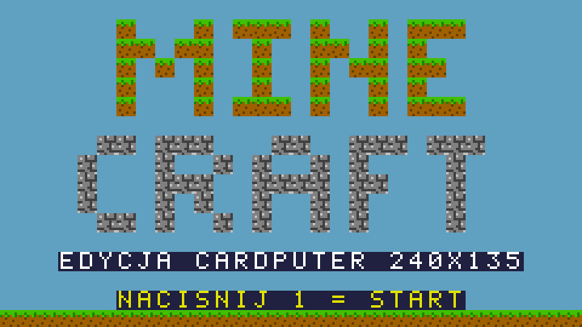
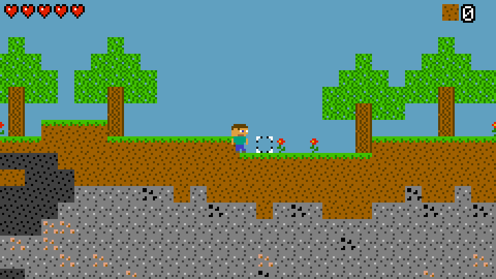
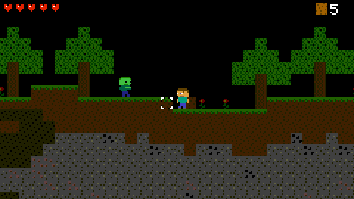
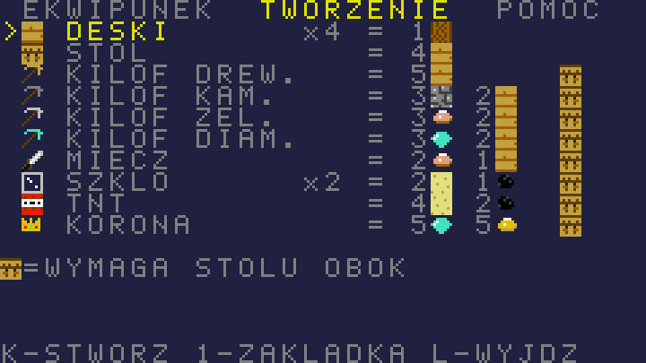

naplet

# MINECRAFT 2D — edycja Cardputer (PC Engine `.pce`)

Grywalny Minecraft w 2D jako ROM **PC Engine / TurboGrafx-16** (`.pce`), zrobiony
pod ekran **M5Stack Cardputer: 240 × 135 pikseli**.

**Plik do wgrania na kartę SD:** [`build/minecraft.pce`](build/minecraft.pce) (32 KB)






## Dlaczego `.pce` i 240×135?

Ekran Cardputera ma 240×135 px (ST7789V2, 1,14"). Żadna z obsługiwanych konsol nie
ma natywnie takiej rozdzielczości (NES 256×240, GB 160×144, SMS 256×192…), więc
emulator musi skalować obraz i wychodzi rozmyty albo z czarnymi pasami.

PC Engine pozwala grze samej ustawić rozdzielczość w rejestrach VDC, a emulator
PCE w [Cardputer Game Station](https://github.com/geo-tp/Cardputer-Game-Station-Emulators)
(pce-go) skaluje obraz według rozmiaru, który ustawi gra. Ta gra ustawia
**dokładnie 240×135** (HDW = 30 kafli, VDW = 135 linii), więc obraz jest
wyświetlany **piksel w piksel**, bez skalowania i bez ramek.

## Sterowanie (Cardputer Game Station)

| Klawisz | Przycisk PCE | Akcja |
|---|---|---|
| **A / D** | lewo / prawo | ruch |
| **E / S** | góra / dół | celowanie w górę lub w dół (z A/D: po skosie) |
| **K** (lub J) | I | skok |
| **L** | II | kopanie (trzymaj) / atak |
| **1** | RUN | postaw blok trzymany w ręce / zjedz jabłko |
| **2** | SELECT | menu: ekwipunek, tworzenie, pomoc |

W menu: E/S/A/D wybór, **K** zatwierdź, **1** następna zakładka, **L** lub **2** wyjście.

## Co jest w grze

- Losowy świat 128 × 47 bloków (inny przy każdym starcie): wzgórza, pustynia,
  drzewa, kwiaty, jaskinie, warstwy ziemi i kamienia, skała macierzysta.
- Rudy: węgiel, żelazo, złoto, diament (im głębiej, tym rzadsze i cenniejsze).
- Kopanie z czasem zależnym od twardości bloku i kilofa, z animacją pękania.
- Stawianie bloków (ziemia, bruk, drewno, deski, piasek, szkło, TNT, kwiaty, stół).
- **Tworzenie (crafting)**: deski, stół rzemieślniczy, kilofy drewniany, kamienny,
  żelazny i diamentowy, miecz, szkło, TNT, korona. Bardziej zaawansowane przepisy
  wymagają stołu w pobliżu.
- Poziomy narzędzi tak jak w Minecrafcie: kamień wymaga kilofa, żelazo kamiennego,
  a złoto i diament żelaznego.
- Cykl dnia i nocy (około 6 minut). W nocy ciemniejszy świat i **zombie**, które
  w dzień płoną na słońcu.
- 5 serc, obrażenia od upadku, zombie i wybuchów. Jabłka (wypadają z liści)
  leczą o 2 serca.
- TNT: postaw, uderz (L), uciekaj. Wybuch niszczy teren i może wywołać reakcję łańcuchową.
- Muzyka i efekty dźwiękowe na PSG.
- Cel gry: zdobyć 5 diamentów i 5 sztabek złota i stworzyć **koronę**. Potem
  można grać dalej.

## Budowanie ze źródeł

Wymagane: `cc65` (≥ 2.18, `apt install cc65`), Python 3, `make`.

```sh
make            # tworzy build/minecraft.pce
```

- `src/main.c` – cała logika gry (C, cc65)
- `src/hw.s` – sterowniki VDC/VCE/joypada (asembler HuC6280)
- `src/crt0.s` – kod startowy i przerwanie VBlank
- `tools/gen_assets.py` – grafika (bloki, sprite'y, czcionka), palety i muzyka jako ASCII art → `src/assets.c`
- `src/pce.cfg` – mapa pamięci HuCard 32 KB

Świat jest zapisany bezpośrednio w tablicy BAT układu VDC (128×64 kafli), więc
nie zajmuje 8 KB RAM-u konsoli. Wiersze 47–63 tej tablicy służą jako ekran menu.

### Test w emulatorze

`tools/test/build_harness.sh` kompiluje bez okna ten sam rdzeń (pce-go), którego używa
Cardputer. Tester przyjmuje skrypt z wejściem i robi zrzuty ekranu:

```sh
tools/test/build_harness.sh
printf "60 -\n3 T\n120 -\n60 R\nshot gra.ppm\n" | tools/test/harness build/minecraft.pce
```

Na rdzeniu pce-go gra działa w pełnych 60 kl./s (sprawdzone na około 47 tys. klatek
losowego sterowania, bez zawieszeń).

## Uwagi

- Emulator PCE w Cardputer Game Station nie obsługuje zapisu stanu dla PC Engine,
  więc każde uruchomienie to nowy świat.
- ROM jest napisany zgodnie ze sprzętem PC Engine, więc powinien działać też w innych
  emulatorach (Mednafen, RetroArch), ale testowałem go tylko na rdzeniu pce-go.
